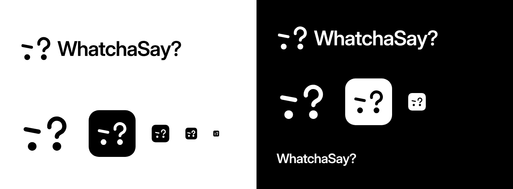

# WhatchaSay? — логотип

Чёрно-белый минималистичный логотип расширения-компаньона для просмотра кино в оригинале.



## Идея знака

Скептичное лицо «чё он сказал?», собранное из пяти элементов:

- слева — ровная бровь и глаз;
- справа — поднятая бровь, которая одновременно крючок вопросительного знака, а глаз под ней — его точка.

Лицо и вопрос читаются одновременно: зритель, который не понял шутку, — ровно та ситуация, в которой нужно расширение.

## Файлы

| Файл                                       | Назначение                                    |
| ------------------------------------------ | --------------------------------------------- |
| `logo-horizontal-black.svg` / `-white.svg` | Основной логотип: знак + «WhatchaSay?»        |
| `logo-wordmark-black.svg` / `-white.svg`   | Только надпись                                |
| `mark-black.svg` / `mark-white.svg`        | Только знак, прозрачный фон                   |
| `icon-black.svg` / `icon-white.svg`        | Иконка приложения (скруглённый квадрат)       |
| `icon-small.svg`                           | Иконка с утолщёнными линиями для 16–32 px     |
| `png/icon-{16,32,48,128}.png`              | Готовые иконки для `manifest.json` расширения |
| `concepts/`                                | Листы с отброшенными направлениями            |

Надпись набрана Inter Display SemiBold и переведена в кривые — шрифт устанавливать не нужно.

```json
"icons": {
  "16": "png/icon-16.png",
  "32": "png/icon-32.png",
  "48": "png/icon-48.png",
  "128": "png/icon-128.png"
}
```
